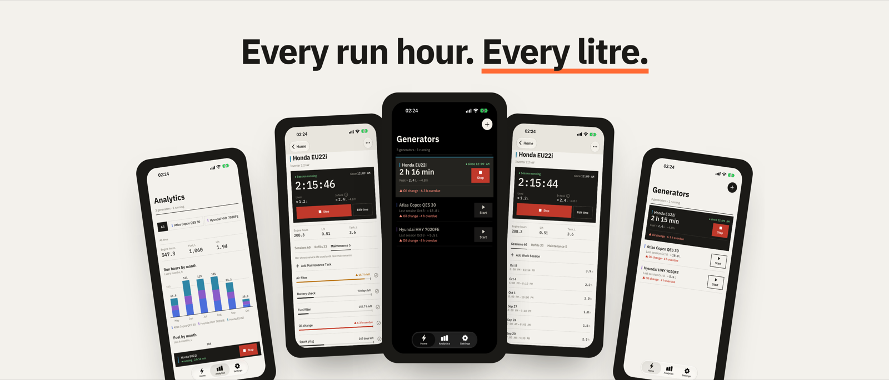
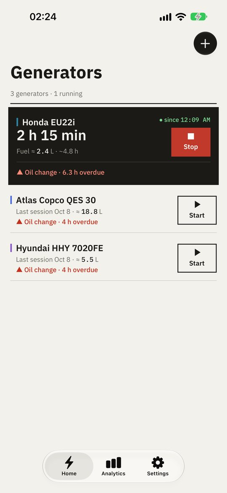
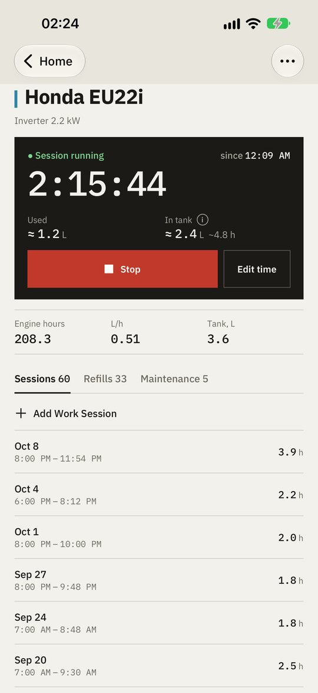
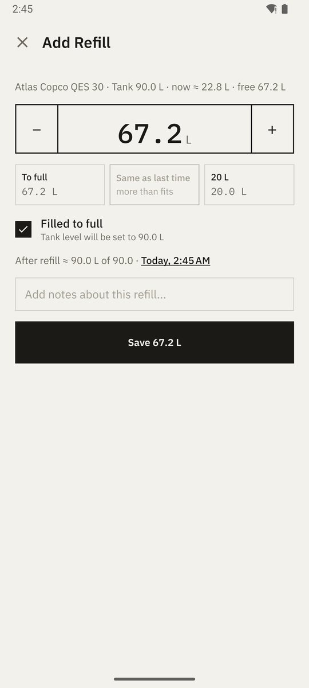
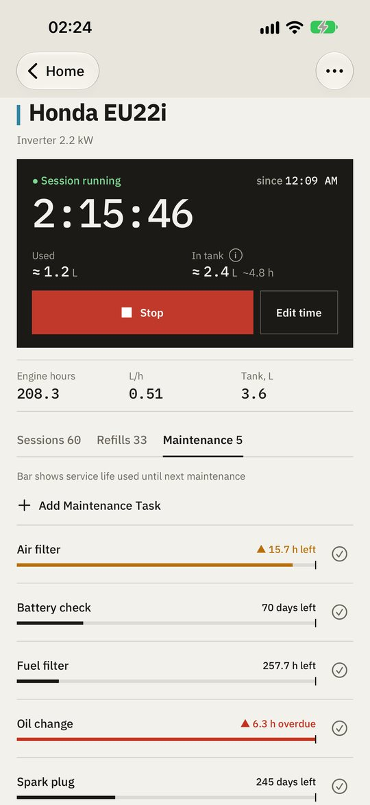
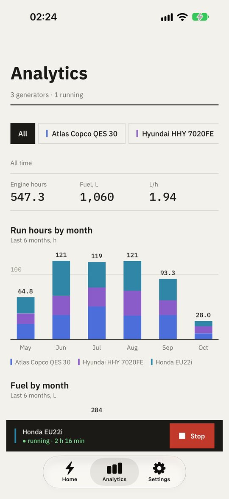
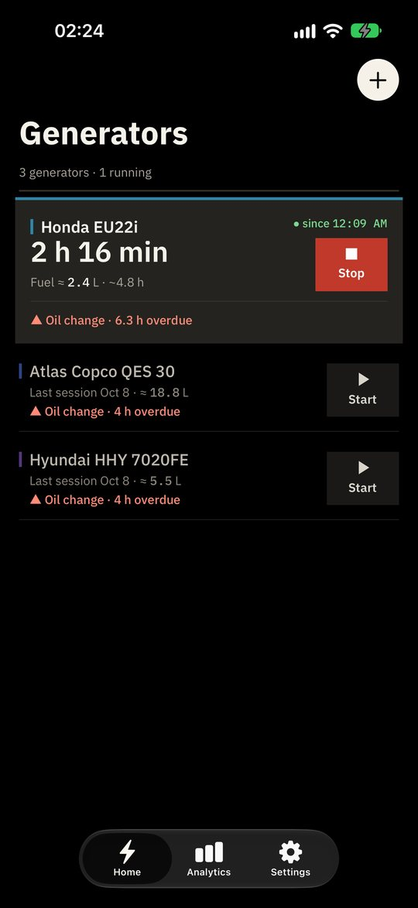
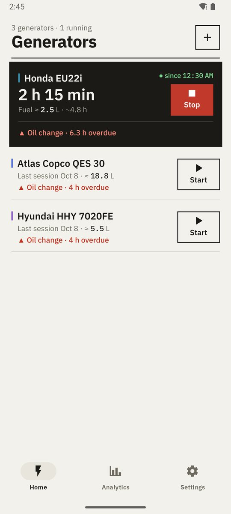

# Generator Tracker: a logbook for your generator, in your pocket — looking for beta testers

If you rely on a generator — for scheduled blackouts, a cabin, a van, a job site or a rental fleet — the same questions keep coming up: how many hours has it run? When is the next oil change due? How much fuel is left, and how much does it burn per hour?

Most owners keep a paper log, a spreadsheet, or nothing at all until the engine starts asking for a service. I'm a developer from Ukraine, where scheduled outages made generators an everyday appliance, so I built **Generator Tracker**: a simple generator logbook that does the counting for you.

## One tap to start and stop

Start the generator, tap **Start**. Shut it down, tap **Stop**. The app counts engine hours, and running generators move to the top with a live timer. Several generators can run at once. Stopped by mistake? **Undo** brings the session back. Forgot to tap? Fix the start time or add the session later.

## How much fuel is left

 

Enter the tank size and the app estimates the fuel and runtime left. Logging a refill takes a few taps, and litres per hour are calculated from your refills.

## Maintenance on time

Oil, filters, spark plugs — set an interval by engine hours, days or both. Each task shows how much of its interval is used, and overdue maintenance shows right on the home screen.

## Charts instead of a notebook

Engine hours and fuel per month, all-time totals and consumption per generator — handy at home, even more so for a site or a rental fleet.

## Day and night

Big high-contrast buttons you can hit in the dark or with gloves on, a paper-coloured light theme, and a true black theme that saves battery when the power is out.

## Private by default

Everything is stored on your phone and works fully offline. An account is optional — it only syncs your records between your own devices, and you can delete it together with the cloud data at any time. The code is open source: [github.com/yuri-val/GeneratorTracker](https://github.com/yuri-val/GeneratorTracker).

## How to try it

**iPhone and iPad — free on the App Store.** Ads only on the Analytics and Settings screens, up to 3 generators; ads and limits can be removed with a one-time purchase, no subscription.
👉 [apps.apple.com/app/id6819560707](https://apps.apple.com/app/id6819560707)

Want new versions first? There's a public TestFlight beta: [testflight.apple.com/join/wZcGdJar](https://testflight.apple.com/join/wZcGdJar).

**Android — free Generator Tracker Lite, closed testing.** Google will publish it on Play once at least 12 people have tested it for 14 days, so every tester really helps:
1. Join the group [groups.google.com/g/generator-tracker-lite](https://groups.google.com/g/generator-tracker-lite) (with the same Google account you use on Play).
2. Opt in: [play.google.com/apps/testing/com.yurival.GeneratorTrackerLite](https://play.google.com/apps/testing/com.yurival.GeneratorTrackerLite).
3. Install the app from Google Play and keep it for at least 14 days.

**Android — the full version, no ads and no limits.** A one-time purchase on Google Play, no subscription:
👉 [play.google.com/store/apps/details?id=com.yurival.GeneratorTracker](https://play.google.com/store/apps/details?id=com.yurival.GeneratorTracker)

English and Ukrainian, phones and tablets. More at [generatortracker.yuri-val.dev](https://generatortracker.yuri-val.dev/).

Feedback is very welcome: what's missing, what's confusing, which generator you run. Comment below, email yuri.valigursky@gmail.com or open a [GitHub issue](https://github.com/yuri-val/GeneratorTracker/issues).
