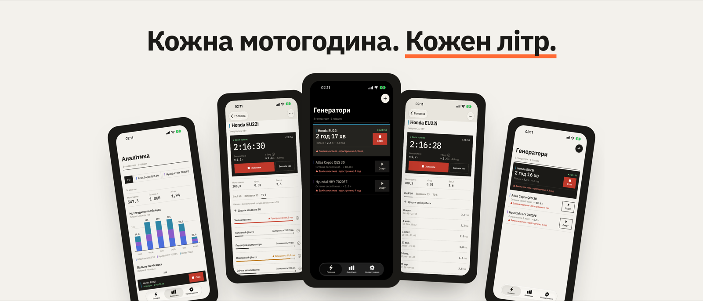
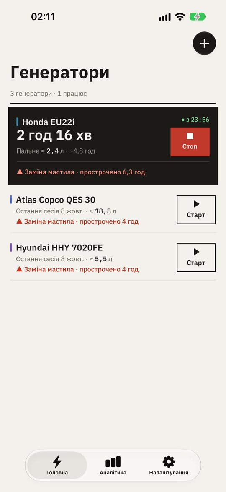
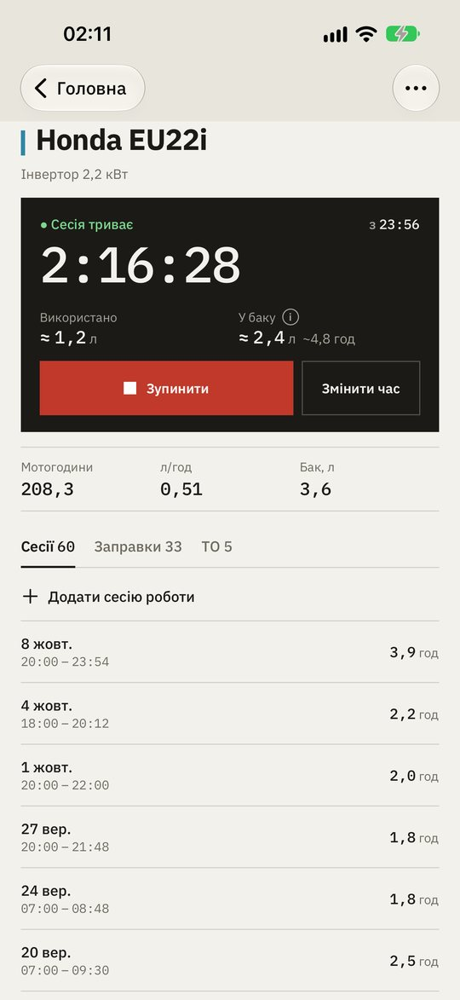
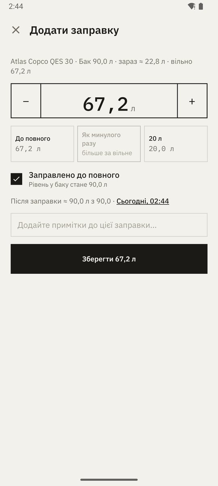
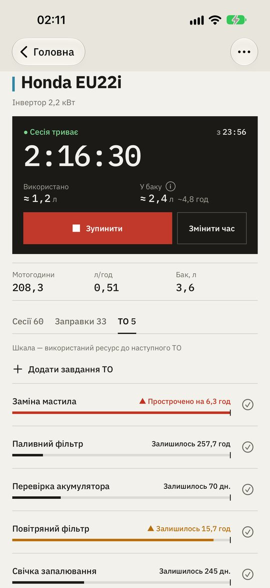
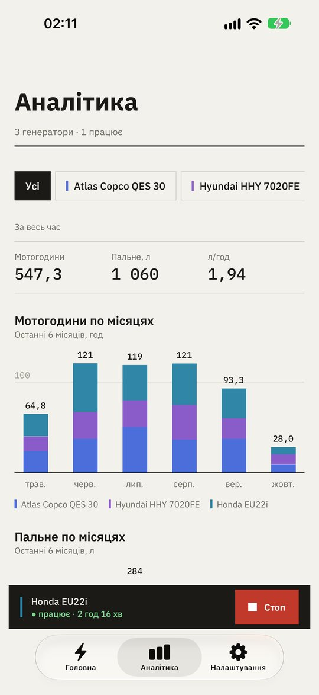
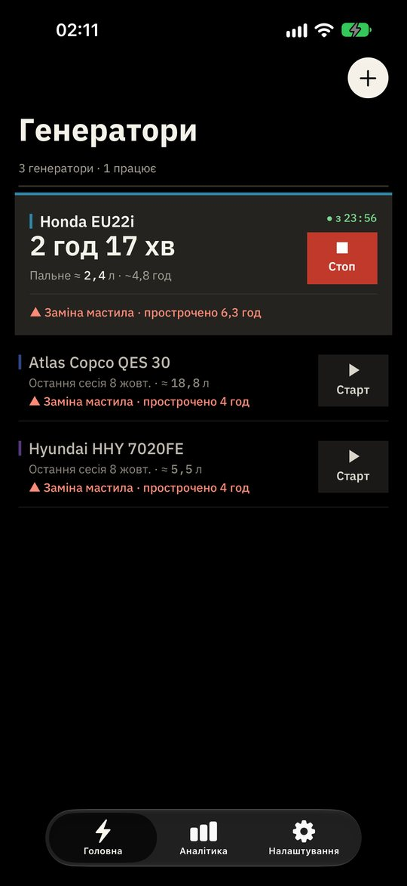
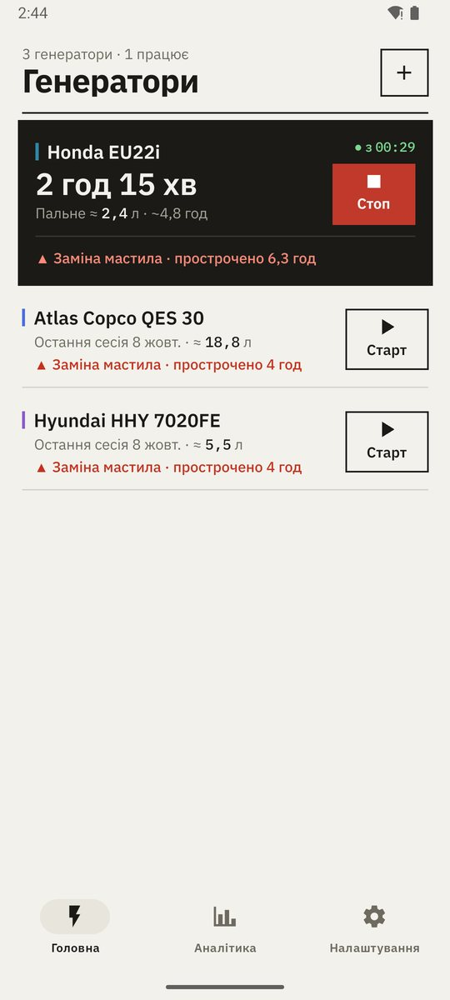

# Generator Tracker: журнал генератора в телефоні — шукаю тестувальників

Коли світло вимикають за графіком, генератор стає побутовою технікою, яка працює годинами щодня. І одразу виникають прості питання, на які важко відповісти напам'ять: скільки він уже відпрацював? Коли міняти мастило? Скільки пального лишилось у баку і скільки він їсть за годину?

Хтось веде зошит, хтось — таблицю, більшість — не веде нічого, доки двигун не почне «просити» ТО. Я — розробник з України, і зробив **Generator Tracker**: простий журнал генератора, який рахує все сам.

## Старт і стоп одним дотиком

Запустили генератор — натиснули «Старт». Заглушили — «Стоп». Застосунок рахує мотогодини, а генератори, що працюють зараз, піднімаються нагору з живим таймером. Кілька генераторів можуть працювати одночасно. Зупинили помилково — «Скасувати» поверне сесію; забули натиснути — час можна виправити.

## Скільки пального лишилось

 

Вкажіть об'єм бака — і застосунок покаже, скільки приблизно пального й годин роботи залишилось. Заправка — за кілька дотиків, а літри на годину рахуються самі з ваших заправок.

## ТО вчасно

Мастило, фільтри, свічки — інтервал за мотогодинами, днями або обома. Кожне завдання показує, яку частину інтервалу вже використано, а прострочене ТО видно просто на головному екрані.

## Графіки замість зошита

Мотогодини й пальне по місяцях, підсумки за весь час і витрата для кожного генератора — зручно для дому, а ще більше для об'єкта чи прокатного парку.

## Удень і в темряві

Великі контрастні кнопки, у які легко влучити в темряві чи в рукавицях, світла тема кольору паперу й справжня чорна тема, що береже батарею, коли світла немає.

## Приватність

Усе зберігається на телефоні й працює повністю офлайн. Обліковий запис не обов'язковий — він лише синхронізує ваші записи між вашими пристроями, і його можна видалити разом із даними будь-коли. Код відкритий: [github.com/yuri-val/GeneratorTracker](https://github.com/yuri-val/GeneratorTracker).

## Як спробувати

**iPhone та iPad — публічне тестування в TestFlight.** Безкоштовна версія 3.1: реклама лише на екранах Аналітики й Налаштувань, до 3 генераторів. Рекламу й обмеження можна прибрати разовою покупкою, а в TestFlight покупки безкоштовні.
👉 [testflight.apple.com/join/wZcGdJar](https://testflight.apple.com/join/wZcGdJar)

Або одразу з App Store: [apps.apple.com/app/id6819560707](https://apps.apple.com/app/id6819560707). Поки там платна версія 2.6, а щойно Apple схвалить 3.1, застосунок стане безкоштовним.

**Android — безкоштовна Generator Tracker Lite, закрите тестування.** Google випустить її в Play, коли щонайменше 12 людей протестують її 14 днів, тож кожен тестувальник дуже допомагає:
1. Вступіть у групу [groups.google.com/g/generator-tracker-lite](https://groups.google.com/g/generator-tracker-lite) (тим самим Google-акаунтом, що й у Play).
2. Підтвердіть участь: [play.google.com/apps/testing/com.yurival.GeneratorTrackerLite](https://play.google.com/apps/testing/com.yurival.GeneratorTrackerLite).
3. Встановіть застосунок із Google Play і не видаляйте його хоча б 14 днів.

**Android — повна версія без реклами й обмежень.** Разова покупка в Google Play, без підписок:
👉 [play.google.com/store/apps/details?id=com.yurival.GeneratorTracker](https://play.google.com/store/apps/details?id=com.yurival.GeneratorTracker)

Українська й англійська мови, телефони й планшети. Більше — на [generatortracker.yuri-val.dev](https://generatortracker.yuri-val.dev/).

Буду дуже вдячний за відгуки: чого бракує, що незрозуміло, яким генератором ви користуєтесь. Пишіть у коментарях, на yuri.valigursky@gmail.com або в [GitHub Issues](https://github.com/yuri-val/GeneratorTracker/issues).
